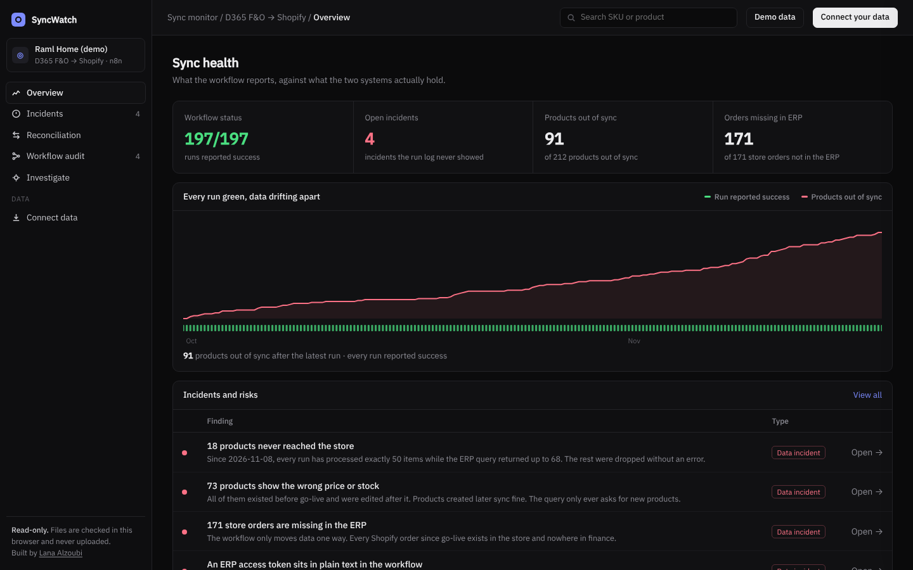
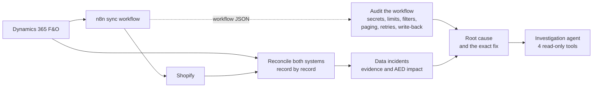

# SyncWatch

**Your integration says "Success". SyncWatch checks whether the data agrees.**

[](https://lanaalzoubi521-lab.github.io/syncwatch/) [](https://github.com/lanaalzoubi521-lab/syncwatch/actions/workflows/test.yml)   

**[Open the live demo →](https://lanaalzoubi521-lab.github.io/syncwatch/)** Runs in the browser with a full demo dataset. Nothing to install.

Most ERP to e-commerce integrations fail quietly. The workflow runs on schedule, every run is green, and meanwhile the store shows last month's prices, new products never appear, and online orders never reach finance. Nothing throws an error, so nothing gets fixed.

SyncWatch watches the outcome instead of the run log. It replays the sync, reconciles both systems record by record, reads the workflow file, and reports every place where the data and the "Success" status disagree, with the evidence, the business impact in AED, the root cause, and the exact change to make.



## The demo

*Raml Home*, a fictional Dubai homeware retailer, syncs Microsoft Dynamics 365 Finance & Operations to Shopify with an n8n workflow. It went live on 1 October 2026 and has reported 197 successful runs with zero errors. SyncWatch finds four silent failures:

| # | What the data shows | Root cause |
|---|---|---|
| 1 | 18 ERP products never reached the store | A `Limit` node set to 50, left in from testing |
| 2 | 73 products show the wrong price or stock, with stock oversold and items sold below the ERP price | The ERP query filters on `CreatedDateTime` with a fixed date, so edits to existing products are never fetched |
| 3 | 171 Shopify orders have no sales order in the ERP | The workflow has no write-back step |
| 4 | An ERP access token is stored in plain text | The token sits in an HTTP header instead of n8n's credential store |

These are the same four classes of issue found in a real production review of a Dynamics 365 to Shopify integration.

## How it works

**Two kinds of finding.** *Data incidents* are proven by comparing both systems record by record. *Workflow risks* come from auditing the n8n workflow file. When both exist, each incident is linked to the workflow setting that causes it.

**Workflow audit** (works on any exported n8n workflow): plain-text secrets, Limit nodes, filters on creation date or fixed dates, nodes that pass errors on as success, OData reads without pagination, HTTP calls without retry, one-way flows with no write-back, and workflows with no error alert.

**Your own data.** Drop in an ERP product export and a Shopify product export (and optionally the n8n workflow, Shopify orders and ERP sales orders). Column names from Dynamics 365 F&O and Shopify exports are recognised. Sample export files are downloadable from the app to try the flow.

**Fixes are replayed, not assumed** (demo). Approving a fix changes the workflow configuration, replays every scheduled run since go-live, and reconciles again. When one fix also clears another finding, SyncWatch says so. Every approval is logged.

**Investigation agent** (when a language model is connected; the hosted version runs on Claude): takes a symptom in plain words, such as *"customers see old prices"*, and works it out with four read-only tools: `get_run_log`, `compare_systems`, `get_workflow`, `get_product`. It reports causes with the numbers it found and changes nothing. Customer data reaches it only inside tool results, which it is instructed to treat as data. See [SECURITY.md](SECURITY.md).

**Daily monitor for n8n.** [`n8n/syncwatch-daily-check.json`](n8n/syncwatch-daily-check.json) is an importable workflow that runs the core check every morning: reads every ERP product page by page, reads every Shopify product, compares SKUs and prices, and emails the team when they differ. Set your ERP URL, credentials and email addresses; the field names are at the top of the Compare node. Its comparison logic is covered by the test suite.

## How it fits together



The importable [daily monitor](n8n/syncwatch-daily-check.json) runs the core comparison inside n8n every morning and emails the team when the systems differ.

## Built with

Vanilla JavaScript (ES modules), no runtime dependencies · n8n workflow JSON · Dynamics 365 OData and Shopify export formats · LLM tool calling · `node:test` · GitHub Actions CI

## Run it

No dependencies. Node 18 or later.

```bash
npm test          # 26 tests: replay, detectors, workflow audit, real exports, secret handling, the n8n monitor
npm run build     # writes dist/index.html, one self-contained file
```

## Structure

```
src/data.js     demo world: ERP products, Shopify state at go-live, orders, schedule, workflow JSON
src/csv.js      file import: encodings, delimiters, number formats, column recognition
src/engine.js   replay, reconciliation, detectors, workflow audit, secret scanning
src/agent.js    agent tools and prompt
src/app.js      interface
n8n/            importable daily monitor workflow and its Compare code
test/           node:test suite
```

## Author

Lana Alzoubi · AI & Automation · [lanaalzoubi.com](https://lanaalzoubi.com)

MIT License.
